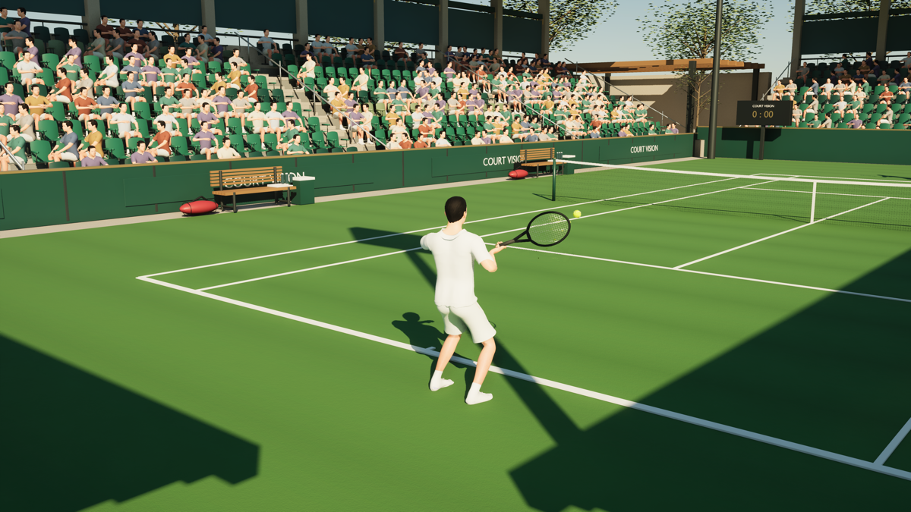

# CourtVision — webcam-controlled tennis

I'm building a tennis game that turns an ordinary webcam into a motion controller. Move your torso to position the player; swing your hand to control a shot's power, direction, and spin. The aim is a physical, expressive sports game without a dedicated controller or headset.

Built by Jason Fang with AI-assisted development using Codex. The project began as a Three.js / MediaPipe browser prototype and developed into a native Unreal Engine C++ game with a Swift / Apple Vision motion companion and a Blender asset pipeline.

[View the full 4K game capture](media/gameplay-4k.png)

The image above is an actual capture of the native game. This repository presents native source, tests, and development documentation; it does not contain a downloadable native game or the Unreal content needed to rebuild the full scene.

## What I built

- **Local motion input:** a Swift companion uses Apple Vision body and hand tracking, stance calibration, adaptive smoothing, and torso-relative swing detection. Only control data travels over localhost UDP; camera frames stay on the device.
- **Tennis simulation:** fixed 240 Hz physics with gravity, aerodynamic drag, spin lift, surface-specific bounce and friction, trajectory prediction, and moving racket contact. Match logic includes service faults, deuce, tiebreaks, and best-of-three sets.
- **Character motion:** procedural/authored strokes, two-handed backhand constraints, palm-relative racket attachment, continuous contact/follow-through timing, and world-space foot planting. Players approach short balls and can volley near the net.
- **Presentation:** a Blender-to-Unreal stadium and athlete pipeline, four court surface profiles, lighting, spectators, and procedural audio. The four profiles share one stadium.
- **Diagnostics:** repeatable motion scenarios, bone telemetry, camera angles, slow playback, and frame stepping to examine defects that static screenshots miss.

## Why it is hard

**Noisy tracking has to feel intentional.** Smoothing reduces jitter but can delay a fast swing. A sidestep must move the player without accidentally triggering a shot. Calibration, confidence checks, torso-relative hand motion, rearming, and tracking-loss handling all affect whether the controls feel predictable.

**The camera and renderer run on different clocks.** A short swing event can disappear if the renderer drains several input packets at once. The motion protocol retains an immutable event snapshot with an ID and expiry, while the receiver rejects stale or duplicate events and resets on reconnection.

**Physics and animation have to agree at impact.** A shot can be numerically valid while looking wrong because the racket misses the ball, the wrist snaps, or the feet slide. Work on CourtVision has included correcting animation-time resets at contact, stabilizing elbow and grip constraints, and separating planted feet from upper-body stroke animation.

**A believable rally is a systems problem.** Ball prediction, opponent positioning, swing preparation, collision, follow-through, footwork, and rendering must work together across different shot heights and court surfaces.

## Explore the implementation

| Area | Source |
| --- | --- |
| Tracking, filtering, calibration, swing events | [MotionCore.swift](VisionBridge/Sources/MotionCore.swift) |
| Camera capture and Apple Vision inference | [CameraController.swift](VisionBridge/Sources/CameraController.swift) |
| Local transport | [Transport.swift](VisionBridge/Sources/Transport.swift) |
| Ball simulation, prediction, and scoring | [TennisPhysics.h](Unreal/Source/CourtVision/TennisPhysics.h) |
| Native gameplay integration | [CVTennis.cpp](Unreal/Source/CourtVision/CVTennis.cpp) |
| Footwork | [CVFootwork.h](Unreal/Source/CourtVision/CVFootwork.h) |
| Athlete animation | [CVAthleteAnim.cpp](Unreal/Source/CourtVision/CVAthleteAnim.cpp) |
| Motion inspection | [CVMotionLab.cpp](Unreal/Source/CourtVision/CVMotionLab.cpp) |
| Physics / scoring tests | [PhysicsTests.cpp](Tests/PhysicsTests.cpp) |
| Motion-input tests | [MotionCoreTests.swift](VisionBridge/Tests/MotionCoreTests.swift) |

## Verification and current status

On November 23, 2026, the standalone C++ physics/scoring/footwork checks and Swift motion-core tests were rerun on the source in this repository. Both passed; the Swift suite reported 1,212 assertions. See [verification notes and commands](docs/VERIFICATION.md).

The native game is a development build. Real webcam recognition accuracy and end-to-end latency still need physical playtesting. Animation remains procedural/authored; it is not tennis motion capture. Rendering performance, braking/toe-off, serve movement, and difficult close-body contacts need further refinement.

The [historical validation record](docs/ORIGINAL_VALIDATION.md) describes earlier builds, motion captures, and measurements. Its local capture paths are historical references: the original video and telemetry files are not bundled here. Those observations are distinct from the tests rerun for this publication. A still image is evidence of rendering, not of motion quality or live webcam performance.

The [original project overview](docs/ORIGINAL_README.md) preserves broader build context; its full-project commands require assets and tools outside this source showcase. Athlete and clothing attribution is in [asset credits](docs/ASSET_CREDITS.md), with original notices retained in [Licenses](docs/Licenses).
